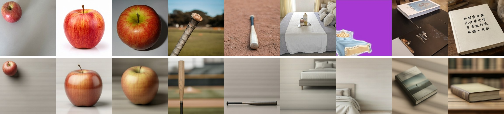
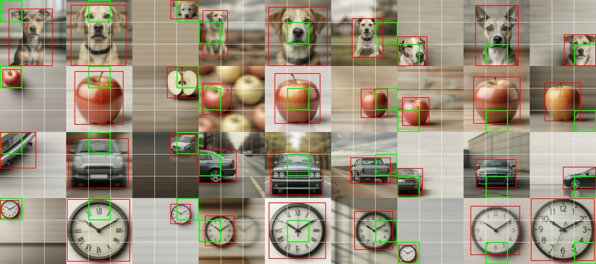
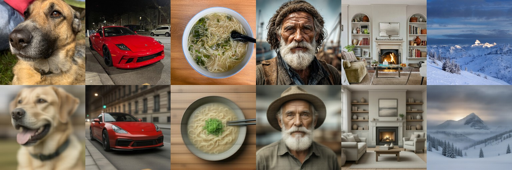
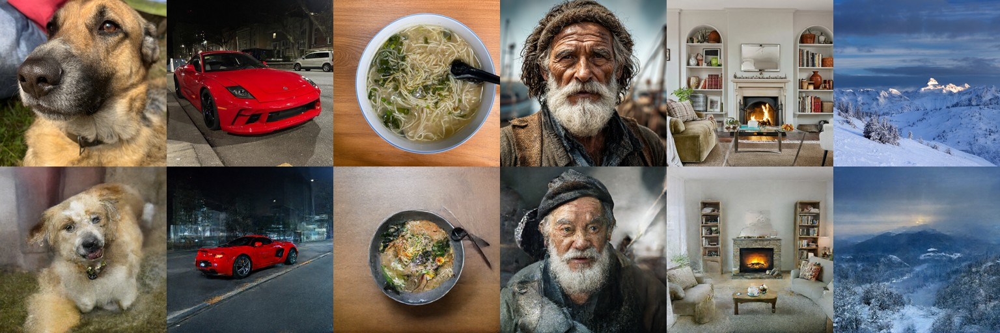
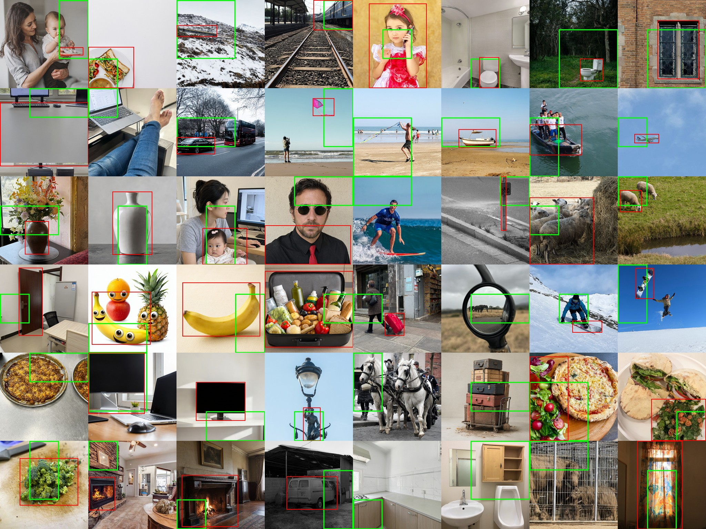
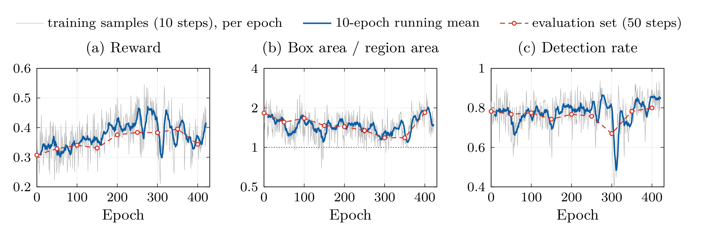
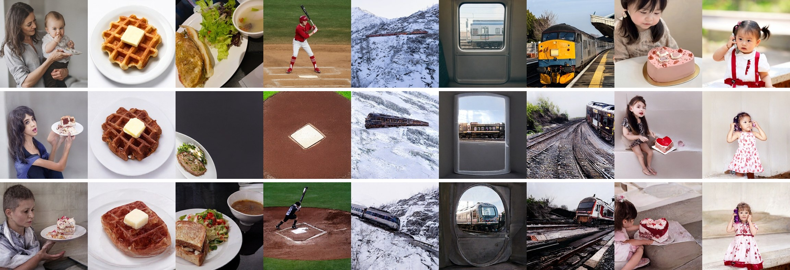

## What I am trying to do

Qwen-Image-2.1 often draws a large dog in the middle of the frame even when the prompt says "a photo of a dog in the top right corner of the image". The goal is to train a LoRA with GRPO so that the model follows this kind of screen-position instruction. This is not a finished result. It is a record of the experiments I ran from November 20 to 24, and of why I moved from each one to the next.

## Background

[Flow-GRPO](https://arxiv.org/abs/2505.05470) trains flow matching models with online reinforcement learning (GRPO), and on SD3.5-M it raises the GenEval position score from 0.24 to 0.99 (Flow-GRPO, Table 1). GenEval's position task, however, measures the relative position of two objects, with prompts of the form "a photo of a/an [OBJECT A] [RELATIVE POSITION] a/an [OBJECT B]" and four relations: above, below, left of, right of ([GenEval](https://arxiv.org/abs/2310.11513), Table 1 and App. C.1). It does not cover instructions about where in the frame an object should be. So I treated screen position as a separate problem to try.

I kept the setup simple. The reward comes from a detector: find the object's box and compare it with the cells of a 3×3 grid over the image. The prompts are the 80 GenEval objects with a position phrase attached.

## Setup

The official Flow-GRPO repository ([yifan123/flow_grpo](https://github.com/yifan123/flow_grpo)) has a config the authors wrote for Qwen-Image (`pickscore_qwenimage_8gpu`). Since it was tuned for a model of the same family, I followed it and changed only what the model and the number of GPUs required.

| Value | Authors' Qwen-Image config | This experiment |
|---|---|---|
| Model | Qwen-Image | Qwen-Image-2.1 |
| Resolution, training / evaluation steps | 512, 10 / 50 | same |
| CFG | 4 | 1.0 (the 2.1 default) |
| Noise level | 1.2 | same |
| Steps used for training | 2 consecutive steps among the first 5 | fixed to the last 2 of the first 5 |
| Images per prompt | 16 | 16 |
| Prompts / images per epoch | 32 / 512 | same (4 H100s) |
| LoRA | r 64, α 128 | same, on four `attn` layers and three `img_mlp` layers |
| Learning rate | 3e-4 | same |
| KL coefficient | 0 | differs per experiment (below) |

Evaluation uses objects that were not trained on. The 80 objects are split into 60 for training and 20 for evaluation, using the repository's `geneval_unseen_objects` split as it is. Below, "evaluation set" means the prompts of these 20 objects.

## The first reward and prompts

There is one prompt template: `a photo of {a/an} {object} in the {cell} of the image`. The nine cell phrases are top left corner, top center, top right corner, middle left, center, middle right, bottom left corner, bottom center and bottom right corner. This gives 540 training prompts (60 objects × 9 cells) and 180 evaluation prompts (20 objects × 9 cells).

The reward looks at the centre of the highest-scoring box that Grounding DINO finds. It is 1 if the centre is in the instructed cell, 0.5 if it is in another cell, and 0 if the object is not found. The 0.5 is there to keep the model from learning to draw no object at all. "Cell accuracy" below is the share of images with reward 1.

One thing had to be fixed in how I used the detector. If asked for a single object name, the detector will find something for that name whatever the image shows. Asked for "zebra." on a picture of a dog, it returned a box (score 0.368). I changed the query to ask for all 80 names at once and to use only boxes whose label equals the target object. On the same picture, dog is then found and zebra is not.

## Before training

Cell accuracy on 720 images (180 evaluation prompts × 4 seeds) is 0.414, against 0.111 by chance. On the same prompts SD3.5-M gets 0.211 and FLUX.1-dev 0.156. Those two models ran with their own default step counts and guidance, so they are only a reference.

The cells differ a lot.

| | left | center | right |
|---|---|---|---|
| top | 0.26 | 0.03 | 0.50 |
| middle | 0.38 | 0.84 | 0.24 |
| bottom | 0.71 | 0.35 | 0.42 |

The model follows corners and the centre to some extent and does not follow the cells in the middle of an edge. For top center, 74 of 80 images were scored as the centre cell. In the pictures, most misses are objects that fill the frame, so the box centre falls in the centre cell.

At 0.41 there was room to improve, so I moved on to training.

## Experiment 1: the authors' config as it is, 100 epochs (`abs_v1`)

I left the authors' config unchanged (KL coefficient 0) and trained for 100 epochs, which took 3 hours 31 minutes.

After training I generated again from the same prompts and seeds as before training and compared the pairs.

| Set | Images | Before | After | Difference (95% interval) |
|---|---|---|---|---|
| Evaluation set (20 objects not trained on) | 720 | 0.414 | 0.478 | +0.064 (+0.026 – +0.100) |
| Training set (60 trained objects) | 540 | 0.431 | 0.502 | +0.070 (+0.037 – +0.104) |

The intervals are a bootstrap over prompts. Accuracy went up, but not by much. It went up about as much on objects that were not trained on, so the model did not memorize the objects. By cell, top left (0.26 → 0.44) and middle left (0.38 → 0.53) improved, while top center (0.03 → 0.01) and middle right (0.24 → 0.15) did not. During training the evaluation value first fell from 0.428 to 0.356 over 40 epochs and then came back up; I did not look into why.

The pictures changed more than the numbers.

- The background of every position prompt turned into a beige or grey wall with horizontal stripes.
- Objects got smaller. The share of the image covered by the detected box went from 0.413 to 0.316 on average.
- Twelve general prompts with no position phrase changed too. The content was kept, but colours faded, backgrounds blurred and texture was lost.

### Why I moved on

I decided to change three things, each for a different reason.

**Reward.** The 1 / 0.5 / 0 reward looks at a single point, the box centre. An object that fills the frame counts as correct if its centre happens to fall in the instructed cell, and an object placed well in a corner counts as wrong if it is large enough for its centre to cross into the next cell. What I wanted the reward to express was "is the object inside the place I asked for". So I changed it to the fraction of the box that lies inside the instructed region.

$$
f = \frac{\text{area}(\text{box} \cap \text{region})}{\text{area}(\text{box})}, \qquad f = 0 \text{ if the object is not found}
$$

At first I thought overflow outside the region would need a separate penalty, but the denominator is the box area, so overflow is already paid for. The weak side of this formula is the opposite one. If the object is drawn very small it fits inside the region easily and f becomes 1. I knew this before starting. I went with f alone for now and logged box area ÷ region area alongside it to keep watch. The 0.5 floor was removed.

**Regions.** The prompts had named one of nine cells. I added regions of two cells side by side, two cells stacked, and 2×2 blocks, because I expected that a scene where the object sits inside a single 1×1 cell would look unnatural most of the time. That makes 25 regions, with 1,500 training prompts and 500 evaluation prompts. Two-cell regions are written by joining two cell names with "and" ("top left and top center"), and 2×2 blocks as "upper left two-thirds".

**KL.** Up to this point the decisions were made before I had seen the 100-epoch evaluation. When that evaluation showed the damage to general prompts, I decided to add a KL term. The authors' Qwen-Image config has none (coefficient 0), so nothing kept the model from drifting away from the original. I had no basis for choosing a value and picked 0.03. The Flow-GRPO paper uses 0.04 for its GenEval experiments (App. B.3).

I also extended the run to 1000 epochs. Accuracy was still rising at epoch 100, and the number of prompts had grown from 540 to 1,500.

## Experiment 2: box-in-region reward, 25 regions, KL 0.03 (`abs_v2`)

The 1000 epochs took 36 hours 45 minutes. Every 50 epochs I measured 500 evaluation images with fixed seeds.

On the evaluation set f starts at 0.396, does not move for 150 epochs, and then jumps to 0.623 between epochs 150 and 200. After that, f and object size move in opposite directions; panels (a) and (b) look like mirror images. When the object gets smaller f rises, and when it gets larger f falls. f reaches 0.765 at epoch 350 (box at 0.31 of the region), drops to 0.503 at 400 (1.43), climbs again to its highest value of 0.834 at 700 (0.45), and after 850 collapses, ending at 0.504 at epoch 1000 (1.63).

In the training samples the detection rate fell to 0.77 around epoch 360, which is when the object was smallest. My guess is that once the object is too small for the detector, the reward becomes 0, and the model swings back toward larger objects. This is a guess. The detection rate also dropped to 0.68 around epoch 173, just before f jumped, and at that point the box was still larger than the region, so the same explanation does not fit there. I have not checked what caused the collapse at 850 either.

I re-measured the LoRA from epoch 700, the best one, on 500 evaluation prompts × 4 seeds = 2,000 images.

| Region type | Images | f, before → after | Box centre in region, before → after | Box area ÷ region area, before → after |
|---|---|---|---|---|
| All | 2,000 | 0.407 → 0.828 | 0.579 → 0.928 | 2.34 → 0.48 |
| 1 cell | 720 | 0.295 → 0.744 | 0.442 → 0.922 | 3.66 → 0.80 |
| 2 cells, side by side | 480 | 0.404 → 0.825 | 0.540 → 0.912 | 1.71 → 0.32 |
| 2 cells, stacked | 480 | 0.386 → 0.871 | 0.573 → 0.933 | 1.86 → 0.31 |
| 2×2 | 320 | 0.698 → 0.956 | 0.956 → 0.956 | 1.10 → 0.23 |

The difference in f over all images is +0.421 (95% interval +0.400 – +0.443). The model did learn position. The share of images whose box centre lies in the instructed region went from 0.58 to 0.93, and that is on objects that were not trained on.

But part of this score comes from drawing the object small. The box shrank from 2.34 times the region to 0.48 times. For 2×2 regions the share of box centres inside the region is 0.956 both before and after, so the rise of f from 0.698 to 0.956 comes from size, not from position. This is what I had worried about before starting.

What I saw in the pictures:

- Epoch 700: a small object in the instructed place, on a dark grey or foggy background.
- With two-cell prompts the model draws several objects. The prompt says "an apple" and two or three apples appear; skis and toothbrush also came out in multiples. The reward looks only at the highest-scoring box, so it does not prevent this.
- In some images (epochs 350 and 700) there is a rectangular patch around the object whose colour differs from the background. I do not know yet what it is.
- Epoch 1000: the object is large again on a white background, and the position is right only some of the time.
- The twelve general prompts keep their content, and colours faded less than in Experiment 1. But even with no position instruction, the car, the bowl and the living room are drawn smaller and farther away. The texture of the man's face and of the dog is smeared.

![Figure 7. The LoRA from epoch 700. Top: before training. Bottom: after. The green rectangle is the instructed region and the red one is the scored box. From the left: apple (top left corner), baseball bat (middle left and bottom left), book (bottom center), bowl (lower left two-thirds), clock (bottom center and bottom right), dog (middle right), elephant (upper left two-thirds), frisbee (center and middle right), skateboard (middle left), skis (top right and middle right), toothbrush (top center and top right), umbrella (top center).](assets/qwen-grpo-log-1/fig07-v2-e700-pairs.jpg)

The KL term did not prevent any of this.

The logged KL value rose over the first 200 epochs and then stayed between 1e-4 and 2e-4 to the end. It looks the same in the stretch where f was highest and after the collapse, so it gave no warning. A small value also does not mean the model is close to the original. The value is a mean per latent element (1,024 tokens × 64 channels = 65,536 elements), and it measures the difference of a single step, at the two of ten steps used for training. Small differences in the same direction at every step can add up to a very different final image. I did not measure the size of the KL gradient and the reward gradient separately.

### Why I moved on

Around epoch 400, looking at pictures where the object shrank and the background emptied, I began to suspect the prompts. Every training and evaluation prompt has the form "a photo of {object} in the {region} of the image" and asks nothing of the background. An empty background with a small object does not violate the prompt. My guess was that the background goes flat because the prompt describes only the object.

So I decided to put a scene in the prompt. At first I tried to pick COCO captions in which exactly one object appears and is the main subject, and then realized that was unnecessary. An existing sentence can be left as it is: choose one object in it and append a position sentence.

> A woman is walking a dog in the city. The dog is in the top right corner of the image.

The chosen object does not have to be the main subject, and other objects can appear with it. That is closer to how prompts are usually written, and since each sentence has a different scene it is also a better place to watch whether the backgrounds converge to one look.

With this there was no reason to stay with the 80 GenEval objects, so I added objects that are common in COCO captions. Taking only objects with at least 300 matching sentences, in order of frequency, gives 132 objects (70 of the original 80 and 62 new ones). Sorted by frequency, every fourth object went to the evaluation set: 99 training objects with 2,475 prompts, and 33 evaluation objects with 825 prompts. I left out person because it refers to the same thing as man, woman, boy and girl.

I also asked whether a 3×3 grid is too fine. One cell is 1/9 of the image, so raising f pushes the object to shrink, and the cells in the middle of an edge were hardly followed even before training. I still kept the 25 regions as they were, to change fewer things at once; if repeated runs fail I will switch to another layout then.

The reward got a size term, because in the epoch-700 evaluation drawing small accounted for a large part of the score and had spread to prompts with no position phrase.

$$
\text{reward} = f \times \min\!\left(1, \frac{\text{box area} / \text{region area}}{0.25}\right)
$$

A box smaller than a quarter of the region loses reward in proportion. I chose 0.25 without any basis.

The detector query had to change as well. The 132 names do not fit in one query (the 80 names already use 198 of 256 tokens). For each image I ask for the target object, the other objects named in the same sentence, and 26 common objects, and use only boxes labelled as the target. The KL coefficient of 0.03 and the 1000 epochs stayed.

## Experiment 3: COCO sentence + position sentence, size term (`abs_v3`)

The starting values already differ from Experiment 2. On 400 evaluation images before training, the reward is 0.307, the box centre is in the region for 0.415 of the images, and the detection rate is 0.782, lower than the 0.97 of Experiment 2. In some images the target is a minor element of the scene (shirt, pan, book) or the model does not draw it at all, and the changed detector query may also play a part. I did not separate the two.

The evaluation reward rose slowly from 0.307 to 0.395 at epoch 350 and came down to 0.344 at 400. The share of box centres in the region went from 0.415 to 0.517 (epoch 350) and then to 0.460. In the training samples the detection rate fell to 0.48 around epoch 311 and the reward dipped with it. After that the object grew again (on the evaluation set, from 1.18 to 1.84 times the region). Over 400 epochs the run did not improve in one direction, and I stopped it at epoch 422.

The pictures at epoch 250 showed something new. The target object moves toward the instructed place, and other content of the sentence goes missing.

- "A woman holding a boy who's eating cake on a plate": the woman holds a plate and there is no boy.
- "the batter is getting ready to take the plate": no batter, only home plate.
- "A white plate topped with an open face sandwich and a salad next to a bowl of soup": a single plate in the corner of a dark, empty frame.

Outdoor scenes that the sentence requires, such as a snowy mountain or railway tracks, remained, but indoor scenes became empty grey or white backgrounds and faces looked off. At epoch 400 the batter and the food are back and position is followed less. The images stay grainy.

Even with a scene in the prompt, the reward looks at one box, the target's. Deleting whatever stands in the way of moving that object costs nothing in reward. It looks as though what happened to the background in Experiment 2 happened here to the content of the sentence (a guess). The size term is in place, and object size and reward still swing together.

### Why I moved on

Damage was already visible at epoch 250. I considered two ways to stop it: raising the KL coefficient, or adding to the reward a check that the sentence content is kept (for example a CLIP score between the sentence and the image).

I decided to change only the KL coefficient. Going from Experiment 2 to 3, I had changed the prompts, the size term of the reward and the detector query all at once, and as a result I cannot tell now which of them caused the difference between the two runs. To avoid repeating that, this time I change one thing. Missing content, empty backgrounds and worse faces are all ways of drifting from the original model, which is what KL targets directly. And since 0.03 stopped nothing in Experiments 2 and 3, a KL term that actually acts had not been tried yet.

I first raised it to 1.0. Over 400 epochs the pictures were not damaged, but the evaluation reward only moved from 0.307 to 0.31–0.32, so position was not learned either. At 0.03 the model learns a little while breaking, and at 1.0 it neither breaks nor learns, so the next experiment uses a value in between, 0.5.

## What I do not know yet

- Whether at KL 0.5 there is a range where position is learned and content is kept. If there is none, the KL coefficient alone is not enough and I will have to look at a reward that sees content.
- How much of the low detection rate in Experiment 3 (0.78) comes from the detector query. Re-scoring the images I already have with a query for the target name alone would tell.
- Why the reward oscillates. "The model gains score by shrinking or deleting, then detection fails and it swings back" is a guess, and I have not looked at why Experiment 2 collapsed at epoch 850.
- How the logged KL value relates to the visible change in the images. The two gradient magnitudes need to be logged separately.
- Whether the cells in the middle of an edge (top center and the like) can be learned at all, and whether 3×3 is the right grid.
- What the rectangular patches in the Experiment 2 images are.
